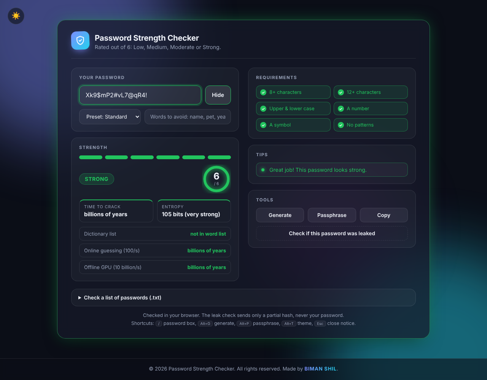
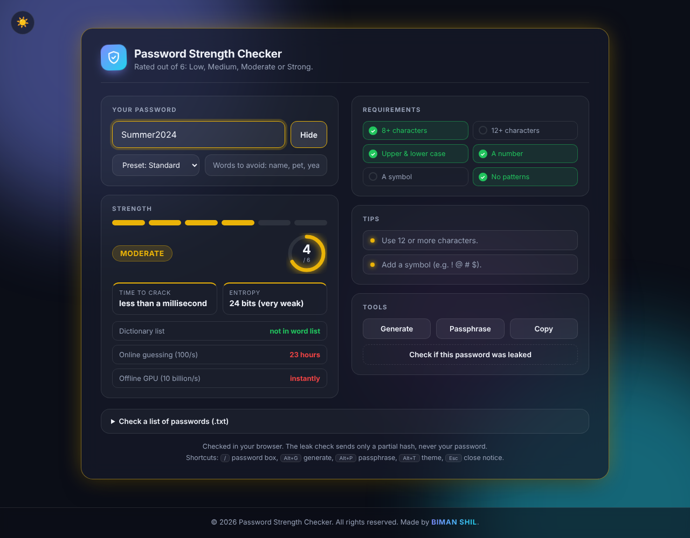
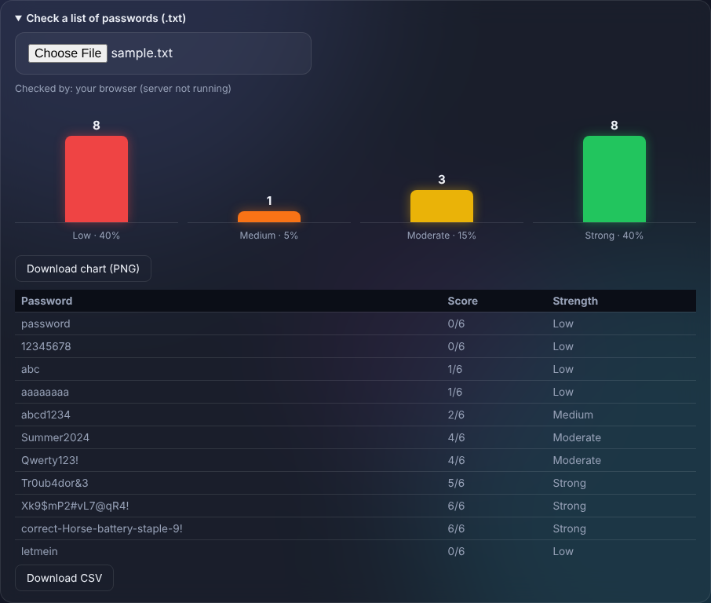
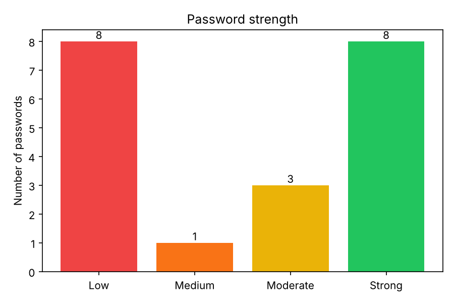

# Password Strength Checker

A cyber security learning project by **BIMAN SHIL**. It rates a password out of 6 (**Low, Medium, Moderate, Strong**) and explains what to improve. It comes in three forms that share the same scoring rules:

- a **command-line script** ([`password_checker.py`](password_checker.py))
- a **website** ([`index.html`](index.html)) that also works as an installable, offline app
- a small **Flask server** ([`app.py`](app.py)) that serves the website and a JSON API

> **Experiment only.** This tool is for learning. It does not guarantee the security of any password. Please do not enter your real passwords.

**Live demo:** [password-strength-checker-biman.netlify.app](https://password-strength-checker-biman.netlify.app/)

## Screenshots

**A strong password** (6/6, every requirement met, crack time in billions of years)



**A pattern-based password** (`Summer2024` passes 4 of 6 rules, but is a word plus a year, so it is cracked almost instantly)



**Bulk check** of a `.txt` list, with a bar chart, table, CSV and PNG download



**Command-line version** saves the same kind of chart as `strength_chart.png`



*The screenshots use sample passwords only.*

## Features

**Checking**
- Score out of 6, strength label, live requirements checklist and tips
- Crack-time estimate and entropy (in bits) that account for patterns, not just length
- Attack simulator: dictionary list, online guessing (100/s), offline GPU (10 billion/s)
- Weak parts of the password highlighted in red
- Common-password list (about 1,650 entries) with leetspeak detection (`p@ssw0rd` is treated as `password`)
- "Words to avoid" box (name, pet, year); matches lower the score
- Strength presets: Standard, Wi-Fi, Email, Bank
- Leak check using Have I Been Pwned (only the first 5 characters of a SHA-1 hash are sent, never the password); a leaked password scores 0

**Tools**
- Random password generator and passphrase generator (uses `crypto.getRandomValues`)
- Copy button that clears the clipboard after 30 seconds
- Bulk check of a `.txt` file (one password per line) with a table, bar chart, CSV download and PNG chart download
- PDF report of the result (never contains the password)

**Experience**
- Light and dark theme, animated background, rainbow cursor trail
- Keyboard shortcuts: `/` password box, `Alt+G` generate, `Alt+P` passphrase, `Alt+T` theme, `Esc` close notice
- Accessible: ARIA meter, screen-reader announcements, skip link, visible focus, readable contrast
- Installable app (PWA) that keeps working when the server is stopped

## Scoring rules

One point each, total 6:

1. 8 or more characters
2. 12 or more characters
3. Upper and lower case letters
4. A number
5. A symbol (anything that is not a letter or number)
6. No sequence (4+ characters in a row such as `abcd`, `1234`, `qwer`, forwards or backwards) and no character repeated 3+ times

Special cases: an empty password scores 0; a common password (or one that is common after undoing look-alike swaps) scores 0.

| Score | Label |
|---|---|
| 0-1 | Low |
| 2-3 | Medium |
| 4 | Moderate |
| 5-6 | Strong |

Presets (website only) add rules such as a longer minimum length or a required symbol. A missing requirement caps the result at Medium.

## How the crack-time estimate works

The website estimates how many guesses an attacker would need. It finds the cheapest way to "explain" the password out of: random characters, sequences, repeated characters, years, dictionary words (with extra cost for capital letters and look-alike swaps) and your avoid-words. It then assumes 10 billion guesses per second and an average of half the possibilities. So `Summer2024` (a word and a year) is cracked almost instantly, while a long random password takes billions of years.

## Run it

**Try it online:** https://password-strength-checker-biman.netlify.app/ (no install needed; bulk checks run in your browser there).

You need Python 3.9 or newer.

**1. Command line**
```
python password_checker.py                 # checks passwords.txt
python password_checker.py my_list.txt     # checks your own file
```
Prints a table and a summary, and saves `password_report.csv` and `strength_chart.png` next to the file. The chart needs `pip install matplotlib` (it is skipped with a note if missing).

**2. Website with the Flask server** (recommended)
```
pip install flask
python app.py
```
Open http://127.0.0.1:5000. Bulk checks run on the Python side; if the server is not running, the page falls back to checking in the browser.

**3. Website only**
Open `index.html` in a browser. Everything works except the installable-app features, which need `http://` (use option 2).

**Install as an app:** open the site through the server, then use the install icon in Chrome's address bar. The app keeps working offline (except the leak check). To remove it completely, uninstall it and tick "Also clear data from Chrome".

## API

| Method and path | Body | Result |
|---|---|---|
| `POST /api/check` | `{"password": "..."}` | `{"score", "label", "feedback"}` |
| `POST /api/bulk` | `{"passwords": ["...", "..."]}` | `{"results": [{"password", "score", "label"}]}` |

Errors: `400` if a value is not text, `413` if more than 100,000 passwords are sent. The server only serves a fixed list of website files, so `.py` and `.txt` files are never exposed.

## Tests

```
pip install pytest flask
pytest
```
- [`test_password_checker.py`](test_password_checker.py): scoring rules, sequences, repeats, labels, file reading
- [`test_checker_extra.py`](test_checker_extra.py): common list, leetspeak, CSV report safety
- [`test_app.py`](test_app.py): every API route, error cases, and that private files return 404

## Project structure

| File | Purpose |
|---|---|
| [`password_checker.py`](password_checker.py) | Scoring logic and command-line tool |
| [`app.py`](app.py) | Flask server and API |
| [`passwords.txt`](passwords.txt) | Sample passwords |
| [`common_passwords.txt`](common_passwords.txt) | Common-password list used by Python |
| [`build_common_js.py`](build_common_js.py) | Builds `common-passwords.js` from the list |
| [`make_wordlist.py`](make_wordlist.py) | Builds `wordlist.js` for the passphrase generator |
| [`index.html`](index.html), [`style.css`](style.css), [`script.js`](script.js) | The website |
| [`common-passwords.js`](common-passwords.js), [`wordlist.js`](wordlist.js) | Word lists for the website |
| [`extras.js`](extras.js) | PDF report and service-worker registration |
| [`sw.js`](sw.js), [`manifest.webmanifest`](manifest.webmanifest), [`icon-192.png`](icon-192.png), [`icon-512.png`](icon-512.png) | Installable offline app |
| [`test_password_checker.py`](test_password_checker.py), [`test_checker_extra.py`](test_checker_extra.py), [`test_app.py`](test_app.py) | Tests |

## Outcome

The project works as a command-line tool, a website and an installable offline app, and its 81 automated tests pass.

**Results on sample passwords** (website; crack times are estimates at 10 billion guesses per second)

| Password | Score | Strength | Estimated time to crack |
|---|---|---|---|
| `password` | 0/6 | Low | less than a millisecond (common password) |
| `abcd1234` | 2/6 | Medium | less than a millisecond |
| `Summer2024` | 4/6 | Moderate | less than a millisecond |
| `Qwerty123!` | 4/6 | Moderate | less than a millisecond |
| `Tr0ub4dor&3` | 5/6 | Strong | about 9,000 years |
| `Xk9$mP2#vL7@qR4!` | 6/6 | Strong | billions of years |
| `correct-Horse-battery-staple-9!` | 6/6 | Strong | billions of years |

On a 20-password sample list, 8 were Low, 1 Medium, 3 Moderate and 8 Strong (see the bulk-check screenshot above).

**What the project showed**
- A rule-based score is not the same as real strength. `Summer2024` has a capital letter, a number and 10 characters, but it is a common word plus a year, so an attacker finds it at once. That is why the crack-time estimate looks at patterns as well as length.
- Length and randomness matter more than adding one symbol. Long random passwords and long passphrases are the only ones that hold up.
- Common passwords, keyboard walks and look-alike swaps (`p@ssw0rd`) are the first things an attacker tries, so they are scored as weak straight away.
- Checking against known breaches can be done privately: only the first 5 characters of a SHA-1 hash are sent, never the password.

**What I built and learned**
- The same scoring rules in two languages (Python and JavaScript), kept in sync and covered by tests.
- A small Flask API with input checks, a file whitelist (so source and data files are never served), and tests for the error cases.
- A browser app with accessibility support, light and dark themes, and offline use through a service worker.
- Safe handling of untrusted input: spreadsheet-formula protection in CSV files, `textContent` instead of `innerHTML`, and no password in the PDF report.

**Ideas for later:** add the avoid-words, presets and leak check to the Python tool, use a larger real breach-based word list, and model passphrases more accurately in the crack-time estimate.

## License

Copyright (c) 2026 **BIMAN SHIL**. All rights reserved.

This project is published for viewing and as a portfolio example. No permission is granted to copy, modify, redistribute or use it, in whole or in part, without written permission from the author. See the [`LICENSE`](LICENSE) file.

---

<p align="center">© 2026 Password Strength Checker. Made by <b>BIMAN SHIL</b>.</p>
